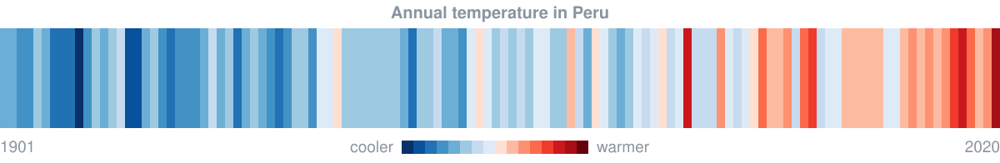

### Hi there, I’m Cristhian

Environmental engineering graduate from Cusco, Peru, working on climate data science and machine learning.

## Research

I work with climate and water data from Peru and the Andes, using machine learning and open datasets to study climate projections, extreme events and drought. I’m also moving into climate change and sustainability consulting, where climate data and models inform physical climate-risk and adaptation decisions.

I’m open to collaborating on climate and water projects, and I’m currently expanding my skills in machine learning and deep learning.

## Selected work

- [CMIP6-CUSCO](https://github.com/Cristhianbgf/CMIP6-CUSCO): climate projections for Cusco
- [peru-basin-drought](https://github.com/Cristhianbgf/peru-basin-drought): drought and water demand in Peru’s basins
- [urubamba-snow-ice-mapping](https://github.com/Cristhianbgf/urubamba-snow-ice-mapping): snow and ice mapping with Sentinel-2
- [friaje-ai-benchmark](https://github.com/Cristhianbgf/friaje-ai-benchmark): AI weather models and cold surges in the Peruvian Amazon

## Tech Stack

<table>
<tr>
<td width="50%" align="center" valign="top">
<h3><picture><source media="(prefers-color-scheme: dark)" srcset="iconos/titulo-datos-oscuro.svg"></picture> Data Science</h3>

 Python • R • Java • pandas • NumPy • Matplotlib • Jupyter • RStudio
</td>
<td width="50%" align="center" valign="top">
<h3><picture><source media="(prefers-color-scheme: dark)" srcset="iconos/titulo-ml-oscuro.svg"></picture> Machine & Deep Learning</h3>

 scikit-learn • LightGBM • PyTorch • TensorFlow • Google Colab
</td>
</tr>
<tr>
<td width="50%" align="center" valign="top">
<h3><picture><source media="(prefers-color-scheme: dark)" srcset="iconos/titulo-clima-oscuro.svg"></picture> Climate & Geospatial Data</h3>

 xarray • CMIP6 • ERA5 • PISCO • Earth Engine • ArcGIS • QGIS • AutoCAD
</td>
<td width="50%" align="center" valign="top">
<h3><picture><source media="(prefers-color-scheme: dark)" srcset="iconos/titulo-reproducibilidad-oscuro.svg"></picture> Reproducible Research</h3>

 Linux (Ubuntu) • Anaconda • Docker • pytest • Git • GitHub
</td>
</tr>
</table>

