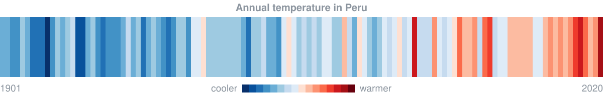

### Hi there, I'm Cristhian

Environmental engineering graduate from Cusco, Peru, working on climate data science and machine learning. This is my GitHub account, where I keep my open-source projects and the code behind my analyses.

## Research

Most of my work applies deep learning and data science to climate and hydrology, from El Niño forecasting with climate model output (CMIP6) and reanalysis (ERA5) to water balance and trend analysis with gridded climate data. I'm also moving into climate change and sustainability consulting, where climate data and models inform physical climate-risk and adaptation decisions.

I’m open to collaborating on climate and water projects, and I’m currently expanding my skills in machine learning and deep learning.

## Tech Stack

<table>
<tr>
<td width="50%" align="center" valign="top">
<h3><picture><source media="(prefers-color-scheme: dark)" srcset="iconos/titulo-datos-oscuro.svg"></picture> Data Science</h3>

 Python • R • pandas • NumPy • Matplotlib • Jupyter
</td>
<td width="50%" align="center" valign="top">
<h3><picture><source media="(prefers-color-scheme: dark)" srcset="iconos/titulo-ml-oscuro.svg"></picture> Machine & Deep Learning</h3>

 scikit-learn • PyTorch • TensorFlow • Google Colab
</td>
</tr>
<tr>
<td width="50%" align="center" valign="top">
<h3><picture><source media="(prefers-color-scheme: dark)" srcset="iconos/titulo-clima-oscuro.svg"></picture> Climate Models & Geospatial Data</h3>

 xarray • Dask • Pangeo • CMIP6 • ERA5 • PISCO • Earth Engine • ArcGIS • QGIS • GeoPandas • rasterio
</td>
<td width="50%" align="center" valign="top">
<h3><picture><source media="(prefers-color-scheme: dark)" srcset="iconos/titulo-reproducibilidad-oscuro.svg"></picture> Reproducibility</h3>

 Anaconda • Docker • pytest • Git • GitHub • Markdown
</td>
</tr>
</table>
