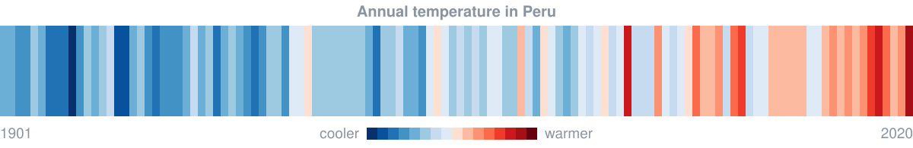

### Hi, I'm Cristhian

BSc in Environmental Engineering (Universidad Andina del Cusco) from Cusco, Peru. I turn climate and air-quality data into products people can use to plan: bias-adjusted climate projections, climate extreme indices and machine-learning early warnings, built with Python and R and published as reproducible code.

Before moving into climate data I worked on electrical infrastructure projects (substation detail engineering and easement surveys for power lines) and on hazardous waste supervision, so I know how field work and engineering deliverables feed into decisions.

## Projects

**[CMIP6-CUSCO](https://github.com/Cristhianbgf/CMIP6-CUSCO)** · Climate projections for the Cusco region at 10 km. I bias-adjusted 10 CMIP6 models with QDM (rainfall bias from 29–100 % down to under 12 %), trained a U-Net that downscales daily rainfall to 10 km, and projected 14 ETCCDI climate extreme indices under three emission scenarios. Cell-level results are downloadable as NetCDF.

**[Air quality in Metropolitan Lima](https://github.com/Cristhianbgf/calidad-aire-lima)** · [Interactive dashboard](https://cristhianbgf.github.io/calidad-aire-lima/) of PM10, PM2.5 and NO2 from the seven SENAMHI stations (2015–2024), compared with Peru's air quality standard and the 2021 WHO guidelines.

**PM10 early warning for a mine** · LightGBM model that warns 2 hours ahead whether PM10 will exceed each station's internal limit (77 % of exceedances detected vs 16 % for persistence), compared with a Temporal Fusion Transformer. The data belong to the mine, so the code is not public.

## Skills

| | |
|---|---|
| **Languages** | Python, R, Java |
| **Software** | Linux (Ubuntu), ArcGIS, QGIS, Google Earth Engine, AutoCAD |
| **Tools** | RStudio, Jupyter, Anaconda |
| **Reproducible research** | Git, GitHub, Docker |
| **Capabilities** | climate projections, hydrology, spatial analysis, machine and deep learning |

## Contact

[LinkedIn](https://www.linkedin.com/in/cristhian-brandon-gamarra-fuentes-7943b2283/) · cristhianbgf@gmail.com
